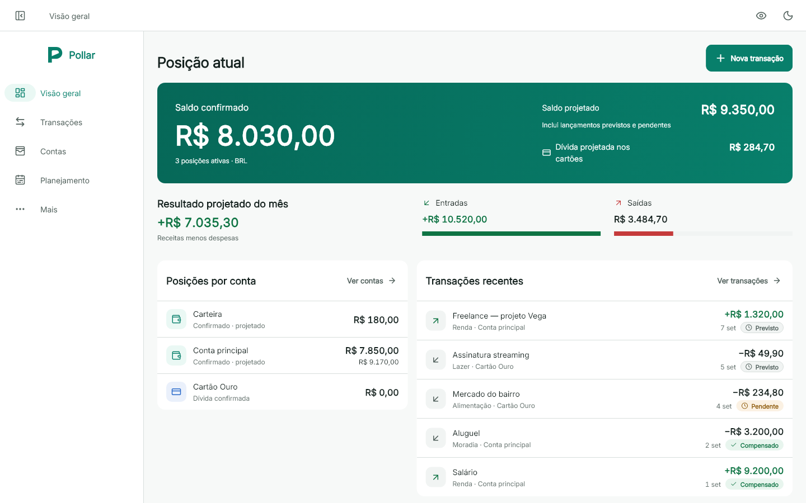
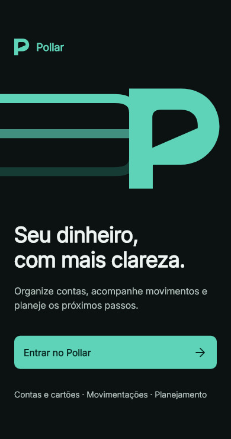
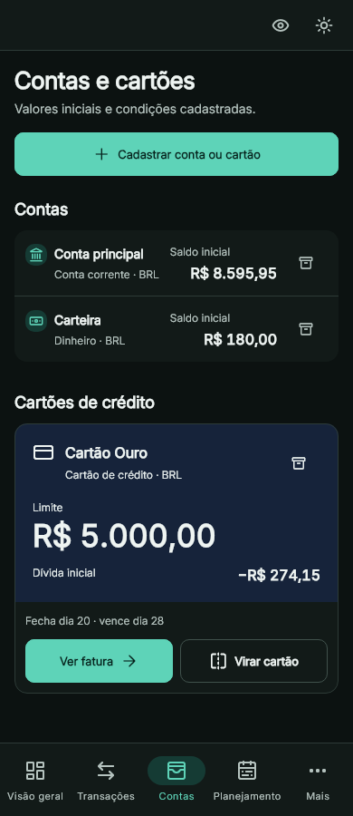

<div align="center">

  <br />

  <picture>
    <source media="(prefers-color-scheme: dark)" srcset="apps/pollar_app/assets/brand/pollar-logo-mint.svg" />
    <source media="(prefers-color-scheme: light)" srcset="apps/pollar_app/assets/brand/pollar-logo-teal.svg" />
    
  </picture>

  <h3>Seu dinheiro, com mais clareza.</h3>

  <p>
    Um gerenciador financeiro pessoal para <strong>Windows e Android</strong>.<br />
    Contas, cartões e planejamento em uma experiência que começa nos seus dados locais.
  </p>

  <p>
    <a href="https://github.com/luaanwp/pollar/releases/latest"></a>
    <a href="https://github.com/luaanwp/pollar/actions/workflows/publish-updates.yml"></a>
    
  </p>

  <p>
    <a href="#baixar">Baixar</a> ·
    <a href="#por-dentro">Conheça o app</a> ·
    <a href="#desenvolvimento">Rodar o projeto</a> ·
    <a href="#proximos-passos">Roadmap</a>
  </p>

  <br />

</div>

<picture>
  <source media="(prefers-color-scheme: dark)" srcset="apps/pollar_app/test/goldens/overview_dark_1440x900.png" />
  <source media="(prefers-color-scheme: light)" srcset="apps/pollar_app/test/goldens/overview_1440x900.png" />
  
</picture>

<p align="center"><sub>Capturas dos testes visuais do aplicativo. Todos os valores e registros exibidos são dados de exemplo.</sub></p>

<a id="baixar"></a>

## A V1 já está lançada

A primeira versão foi lançada em **11 de novembro de 2026**, com distribuição pelo GitHub Releases e atualizações pelo próprio aplicativo.

| Plataforma | Download | Como abrir |
| :-- | :-- | :-- |
| **Windows** | [Baixar ZIP portátil](https://github.com/luaanwp/pollar/releases/latest/download/pollar-windows.zip) | Extraia o ZIP completo e execute `pollar_app.exe`. |
| **Android** | [Baixar APK](https://github.com/luaanwp/pollar/releases/latest/download/pollar-android.apk) | Abra o APK no celular e confirme a instalação pelo Android. |

Depois da primeira instalação, acesse **Mais → Preferências → Verificar atualizações**. O Pollar baixa e verifica o pacote antes de oferecer a instalação.

[Notas da V1](docs/release-notes-v1.md) · [Todas as versões](https://github.com/luaanwp/pollar/releases) · [Como funcionam as atualizações](docs/in-app-updates.md)

<a id="por-dentro"></a>

## Tudo parte do seu livro-caixa

O Pollar distingue o que já aconteceu do que ainda está previsto. Assim, saldo confirmado, projeções e compromissos futuros têm seus próprios lugares.

| Área | O que você pode fazer |
| :-- | :-- |
| **Visão geral** | Conferir saldos confirmados e projetados, resultado do mês e movimentações recentes. |
| **Contas e cartões** | Organizar contas, limites, faturas, compras parceladas e pagamentos. |
| **Transações** | Registrar receitas, despesas e transferências, com categorias, estados e histórico preservado. |
| **Planejamento** | Acompanhar orçamentos, recorrências e compromissos. |
| **Patrimônio e relatórios** | Acompanhar metas, ativos e dívidas manuais, além de consultar relatórios e exportar CSV. |
| **Seus dados** | Fazer backup e restauração locais e sincronizar contas e transações entre dispositivos pelo Supabase. |

<table align="center">
  <tr>
    <th align="center">Uma entrada com a cara do Pollar</th>
    <th align="center">Suas contas, também no celular</th>
  </tr>
  <tr>
    <td align="center" valign="top"></td>
    <td align="center" valign="top"></td>
  </tr>
</table>

### Feito para o uso diário

- **Dados locais primeiro.** O SQLite mantém o livro-caixa disponível no dispositivo, inclusive offline. A sincronização remota é uma capacidade separada.
- **Acesso sem senha.** Confirmação por e-mail e app autenticador, com desbloqueio por Windows Hello ou biometria/PIN em dispositivos previamente autenticados.
- **Histórico financeiro preservado.** Cancelamentos e arquivamentos mantêm o contexto dos registros; transferências e pagamentos de fatura não duplicam receitas ou despesas.
- **Uma interface que se adapta.** Layouts para celular e computador, temas claro e escuro, ocultação de valores, navegação por teclado e respeito a movimento reduzido.

Na V1, a sincronização Supabase cobre **contas e transações**. Planejamento, metas, ativos e dívidas permanecem locais e são incluídos no backup local. Conexão automática com bancos e Open Finance fazem parte do planejamento da próxima versão.

<a id="desenvolvimento"></a>

## Rodando o projeto

O aplicativo fica em [`apps/pollar_app`](apps/pollar_app). A versão do Flutter fixada no CI é **3.47.2**, com Dart incluído.

Prepare o Flutter no `PATH` e as ferramentas da plataforma: Visual Studio com desenvolvimento desktop em C++ para Windows, ou Android SDK e um dispositivo/emulador para Android.

```sh
git clone https://github.com/luaanwp/pollar.git
cd pollar/apps/pollar_app
flutter pub get
flutter run -d windows
```

Para Android, consulte `flutter devices` e substitua `windows` pelo identificador do dispositivo.

### Login e sincronização com Supabase

Sem configuração de backend, o app inicia em modo local. Para habilitar autenticação e sincronização, crie `apps/pollar_app/config/supabase.remote.json` com os dados do **seu projeto**:

```json
{
  "SUPABASE_URL": "https://SEU_PROJETO.supabase.co",
  "SUPABASE_PUBLISHABLE_KEY": "SUA_CHAVE_PUBLICAVEL"
}
```

Depois, a partir de `apps/pollar_app`:

```sh
flutter run -d windows --dart-define-from-file=config/supabase.remote.json
```

Use somente a chave publicável no cliente. Migrações, templates de e-mail, TOTP e configuração do backend estão no [guia de desenvolvimento](docs/setup.md#supabase). Docker é usado para executar o Supabase **localmente**, não para usar o aplicativo baixado.

### Verificações

Na pasta `apps/pollar_app`:

```sh
flutter analyze
flutter test --exclude-tags=windows-process
```

No Windows, os testes nativos do atualizador são executados separadamente, como no CI:

```sh
flutter test --concurrency=1 test/features/updates/windows_update_launcher_test.dart
```

O pipeline também verifica o empacotamento e gera os pacotes Windows e Android antes da publicação. Os registros de aceite ficam em [`docs/v1-acceptance.md`](docs/v1-acceptance.md).

## Por trás da interface

| Camada | Tecnologia |
| :-- | :-- |
| Aplicativo | Flutter e Dart |
| Estado e navegação | Riverpod e go_router |
| Persistência local | Drift e SQLite |
| Autenticação e sincronização | Supabase, PostgreSQL e RLS |
| Identidade visual | Inter, Lucide e componentes próprios do Pollar |
| Verificação e distribuição | Flutter Test, testes de integração e GitHub Actions |

```text
pollar/
├── apps/pollar_app/      Aplicativo Flutter
│   ├── lib/app/         Composição, rotas e tema
│   ├── lib/core/        Dinheiro e regras financeiras
│   ├── lib/features/    Capacidades de produto
│   ├── lib/shared/      Componentes e adaptadores compartilhados
│   └── test/            Testes de domínio, interface e regressão visual
├── supabase/            Migrações, funções, políticas e testes do backend
├── packaging/           Recursos de distribuição
└── docs/                Arquitetura, configuração e evolução do projeto
```

As regras financeiras ficam independentes de Flutter, banco e rede. Valores monetários usam unidades menores inteiras; saldos e relatórios são derivados dos registros. Mais detalhes em [Arquitetura](docs/architecture.md).

<a id="proximos-passos"></a>

## Próximo capítulo: V1.1

O foco planejado é **Open Finance**: conectar bancos, consultar saldos e extratos e conciliar movimentos com o livro-caixa existente.

O [roteiro inicial](docs/v1.1-roadmap.md) está dividido em seis slices, da escolha do provedor ao lançamento. Bancos prioritários, provedor e detalhes da integração ainda serão definidos. A integração bancária não está implementada na V1; uma área de investimentos segue como proposta separada.

## Continue explorando

- [Configuração e desenvolvimento](docs/setup.md)
- [Arquitetura modular](docs/architecture.md)
- [Sistema visual](DESIGN.md)
- [Notas de lançamento da V1](docs/release-notes-v1.md)
- [Atualizações pelo aplicativo](docs/in-app-updates.md)
- [Roadmap da V1.1](docs/v1.1-roadmap.md)
- [Créditos e componentes de terceiros](THIRD_PARTY_NOTICES.md)

---

<p align="center">
  <sub>Pollar · Clareza para acompanhar o presente e planejar os próximos passos.</sub>
</p>
